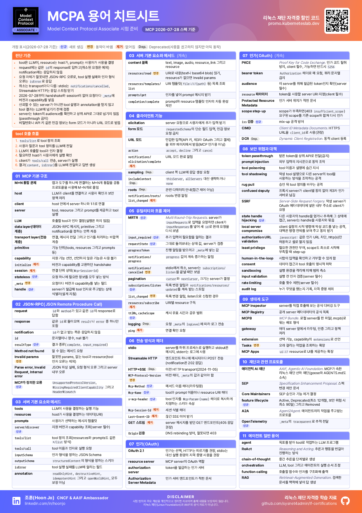
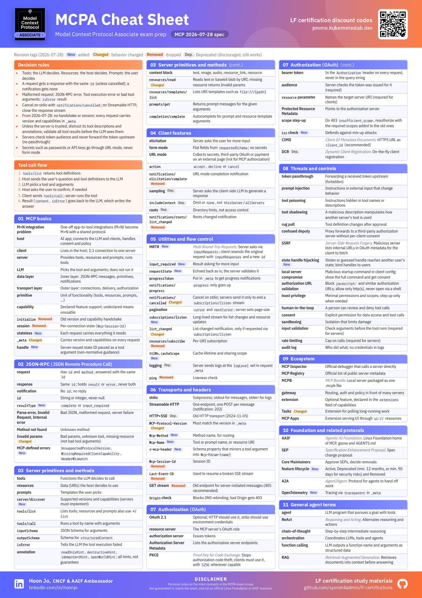

# MCPA 용어 치트시트 (MCPA Cheat Sheet)

[English](#english)

MCPA(Model Context Protocol Associate) 시험 범위의 주요 용어를 A4 한 장에 정리했습니다.
출력할 때는 A3나 A2로 확대하면 글씨가 커서 읽기 편합니다.
MCP 2026-07-28 스펙을 기준으로 했고 이 개정에서 새로 생기거나 동작이 바뀌거나 없어진 항목과
Deprecated 항목에 표시를 달았습니다.

| 언어 | PDF |
|---|---|
| 한국어 | [mcpa-cheatsheet-ko.pdf](mcpa-cheatsheet-ko.pdf) |
| English | [mcpa-cheatsheet-en.pdf](mcpa-cheatsheet-en.pdf) |

## 구성

판단 기준, tool 호출 흐름 그리고 11개 절로 나눴습니다. 절은 MCP 기본 구조, JSON-RPC, 서버 기본 요소와
메서드, 클라이언트 기능, 유틸리티와 흐름 제어, 전송 방식과 헤더, 인가(OAuth), 보안 위협과 대책,
생태계 도구, 재단과 관련 프로토콜, 에이전트 일반 용어입니다.

## 안내

- 시험 범위의 주요 개념을 개인적으로 정리한 자료이며 출제 내용을 보장하지 않습니다.
- 리눅스 재단(Linux Foundation)과 AAIF의 공식 자료가 아닙니다.
- 스펙이 바뀌거나 내용을 수정하면 같은 파일 이름으로 갱신합니다.
- 틀린 곳은 이슈로 알려 주세요.

## English

The main terms in the MCPA (Model Context Protocol Associate) exam scope on one A4 page. For printing,
scale it up to A3 or A2 so the text is easier to read. It is based on
the MCP 2026-07-28 spec, and tags items that were added, changed, removed or deprecated in this revision.

- PDF: [mcpa-cheatsheet-en.pdf](mcpa-cheatsheet-en.pdf) (Korean: [mcpa-cheatsheet-ko.pdf](mcpa-cheatsheet-ko.pdf))
- Certification discount codes: https://promo.kuberneteslab.dev/en/

These are personal notes on the main concepts in the MCPA exam scope. They are not guaranteed to match
the exam, and they are not an official Linux Foundation or AAIF resource. If you find a mistake, please
open an issue.
